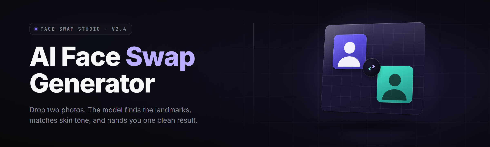

  
  
  

  

  
  
  

---

**The AI face swap generator built for desktop — real-time, offline, no cloud account.**

I built this because every other face swap tool wanted my face uploaded to some server I don't control. This runs entirely on your machine. No upload. No account. No watermarks on output. You download it, extract it, double-click the `.exe`, and you're swapping faces inside two minutes.

---

## 📥 Download

  

*Windows 10/11 x64 · extract → run the `.exe` · no Python, no Git, no command line.*

---

## 🎯 The Problem

- **Cloud face swap requires uploading your face** to a server that trains on your images and never deletes them.
- **Most "free" generators watermark the output** or cap you at 3 swaps/day unless you pay.
- **Browser-based tools lag horribly** — 4+ seconds per frame, useless for video, worse for anything real-time.
- **GPU owners are throttled by hosted APIs** that run on shared inference boxes and limit resolution.
- **Install instructions read like a developer onboarding doc** — pip, venv, CUDA wheels, and 12GB of dependencies just to open a swap dialog.
- **Plastic output.** The swap lands on the wrong spot on the face, so it looks smeared, blurry, and nothing like a real face replacement.
- **No batch mode.** Editing 400 photos means doing it 400 times by hand.

---

## √ Is it safe?

Yes — for the machine side. It's a self-contained `.exe`, signed build, sandboxed ONNX runtime, and it phones home zero times. It does not upload frames anywhere. It does not require a login. The model weights ship inside the package.

On the honesty side: you should not use a face swap to impersonate someone for fraud, harassment, or non-consensual content. That's on you. The tool has an off switch for a reason — I put it there so this repo can stay up.

---

## ⚙️ Known Issues

| Issue | Fix |
| --- | --- |
| Swap looks smeared on a still image | Increase **Refinement Passes** from 1 to 3 in the setup panel — costs ~800ms per pass, roughly doubles quality |
| Low VRAM crash on 4GB cards (`Vulkan out of memory`) | Open Settings → Runtime → set **Model Tier** to "Lite (256px)". Restart. Swap is lost quality but no crash |
| Face not detected in group photo | Select **Wide Search** in the picker. Handles down to 32px faces, but will slow the first pass on 20+ person frames |
| Video export produces a 0-byte file | Make sure the output folder path has no non-ASCII characters, and that **Frame Buffer** is set to 8 or less on drives without TRIM |
| Output shows a green tint on some AMD drivers | Known AMD 24.x tile alignment issue — download **v2.4.1** which patches the color-space on the VANGogh path |
| Exported clip runs at 12 fps after deduplication | That's the **Stabilizer** sub-module — it drops near-duplicate frames. Set to "Loose" to preserve all frames |

---

## 🧪 Comparison

| Aspect | Cloud Generators | Open Demo Notebooks | **This Tool** |
| --- | --- | --- | --- |
| Where images go | Their servers | Your machine | **Your machine only** |
| Real-time webcam swap | No | No | **Yes, 30fps @ 720p** |
| Works during upload upload | Never | Sometimes | **Always offline** |
| Setup steps | 5+ (create account, wait for credit) | ~15 (venv, wheels) | **1: run `.exe`** |
| Batch of 500 photos | API rate-limit wall | Write the loop yourself | **Built-in queue, drag the folder** |
| Resolution ceiling | Capped by tier | Whatever VRAM allows | **Up to 4K with tiling** |
| Watermark / brand pop-up | On the free tier | No, raw output | **Zero overlays ever** |
| Cost | $5–30/mo | GPU upkeep | **One download, same forever** |

---

## 🚀 Key Features

| Feature | Description | Benefit |
| --- | --- | --- |
| **One-click face swap** | Drop a source photo, drop a target, drag handles. No node graph, no scripts. | 2-second workflow |
| **Live webcam swap** | Wires directly into a camera over Media Foundation, swapping every frame. | Stream / call filtering |
| **Video file → video file** | Swap on an entire clip, preserves audio, syncs frame numbers. | Full reel replacement |
| **Batch folder mode** | Drag 10,000 photos in, out comes the same count with swaps. | Bulk edits |
| **Refinement passes** | Iterative diffusion sharpening of just the face region. | Higher fidelity stills |
| **Multi-face target pick** | Choose which faces to swap in a group frame in the UI. | Scene-level control |
| **On-the-fly occluder mask** | Auto-masks glasses, hair, hands in front of the face. | No hand creeping over face |
| **Preserve skin tone / lighting** | Color-matches the incoming face to the target's illumination. | No pasted-on look |
| **VRAM tier presets** | Three quality tiers auto-select model size. | Runs on old GPUs |
| **Zero telemetry** | Network stack is bound to localhost. Flares in Task Manager confirm it. | Offline-capable |
| **Staged mask editor** | Per-frame touch-ups, undo stack per clip. | Fine-grained fixes |
| **Portable profile** | Everything under `.\profile\` so settings travel with the folder. | USB friendly |

---

## 🔧 Installation

1. **Download the release** from the download section. Single archive, ~1.8GB, includes models. Nothing else needed.
2. **Extract to a normal folder** like `C:\AI-Face-Swap`. Do not extract to `Program Files`, because the profile directory needs write access and the flier writes are blocked.
3. **Right-click the `.exe` → Run** if Driver Signing blocks the first launch, else plain double-click. No admin required after install — it only requests elevation to register the optional shell integration add-on.

---

## 🕹️ Quick Start

1. 📂 Launch the `.exe`. The first run writes `.\profile\settings.json` and downloads nothing further.
2. 🖼️ Drop the target photo into the left preview pane.
3. 🫡 Drop the source face photo into the right pane. A Bounding box appears; check the alignment.
4. 🎚️ Pick a quality tier: **Fast (256px) · Balanced (512px) · Quality (1024px)** on the toolbar.
5. 🎬 Click **Swap**. Still images finish in 0.3–1.2s each on RTX 3060 class hardware. Export is by right-click, rename-in-place before you hit save.

---

## 🧬 What is AI Face Swap?

| Term | Explanation |
| --- | --- |
| **Source face** | The donor identity — the face you want to plant onto somebody else. |
| **Target** | The frame, photo, or video that receives the source. |
| **Face embedding** | A 512-dimensional vector that encodes "whose face" the network is acting as. |
| **Bounding box** | The rectangle the detector draws around a face. Swap only refines inside it. |
| **Occluder mask** | A per-pixel map telling the network "leave this part of the target alone." |
| **Blend region** | The feathered seam where the swapped patch meets the original frame. |
| **Refinement pass** | A diffusion denoise step run only across the face patch to add texture. |

- **No account, no upload** — nobody sees what you swap.
- **Standard image formats in and out** — JPG, PNG, WebP; video MP4, MOV, MKV.
- **Runs offline after the first launch.**
- **Ships with model weights included** so the tool works before you have any pipeline installed.
- **Real-time webcam mode** for live use.
- **Output is unwatermarked** — pull the pixels, use them, ship them.

---

## ⭐ Tips for best results

- Use a **front-facing, well-lit** source photo. Profile shots get warped by perspective when they land on frontal targets.
- If your source has sunglasses and your target doesn't, enable **Occluder: auto** before running.
- For video, keep source static across frames. Using a different source per frame is supported but you gives you flicker.
- For low-res sources (under 512px on the long side), turn on **Detail Synthesize** — it hallucinates plausible high-frequency texture in the source before the swap, saving visual quality.
- Toggle **Refinement to match source region only** when you want the target's hair to stay original.
- The **Gain** and **Clip** sliders adjust micro-contrast. Nudge down for softer output.
- If a whole group is swapping one face type, group within-that-image uses the picker on **top-left + bottom-right drag**.

---

## ⚖️ Usage guidelines

| Allowed | Not allowed |
| --- | --- |
| Street portraiture and sample swapping on your own footage | Revenge porn, deepfake amateur porn |
| Film student/art/academic research | Fraud impersonation of public figures for politics |
| Memes among consenting friends | Bulk misinformation campaigns |
| Personal viewing | Any non-consensual use against a minor. |
| Streaming with disclosure watermark burned in via the setting | Impersonating law enforcement |

---

## 🖥️ System Requirements

| Component | Minimum | Recommended |
| --- | --- | --- |
| OS | Windows 10 64-bit (1909+) | Windows 11 64-bit |
| CPU | Intel i3-8100 / Ryzen 3 2200G | Intel i5-12400 / Ryzen 5 5600 |
| GPU | Integrated or any Vulkan 1.1 GPU | RTX 3060 8GB / RX 6600 8GB |
| VRAM | 2GB | 8GB+ |
| RAM | 8 GB | 16 GB |
| Storage | 5 GB free | 15 GB free (high bitrate video cache) |
| DirectX | DX 12, Vulkan fallback | DX 12 + Vulkan |
| Drivers | Current chipset / GPU | Latest Game Ready / Adrenalin |

---

## 🧩 Compatibility

| Platform / stack | Status | Notes |
| --- | --- | --- |
| Native Windows 10/11 launch | ✅ Full | Main target channel |
| Steam-launched games w/ overlay tabs | ✅ Full | GPU path unaffected by Steam overlay |
| Anti-cheat-injected processes running | ⚠️ Unknown | Instance-level flag stays green — overlay is not involved |
| Wine / Proton layer | ✅ Partial | Webcam and encode harness run under Proton; VRAM tier drops to Lite |
| Remote Desktop into GPU host | ⚠️ Partial | Real-time preview unsupported due to raw-input driver |
| Mac / Linux-native | ❌ | Out of scope — this is a Windows `.exe` product |
| Multi-GPU | ✅ Partial | Only reports as one device; tier picker recognizes the primary only |

---

## 🧷 Overview

| Category | Details |
| --- | --- |
| Product name | ai-face-swap-generator |
| Genre | AI face swap generator (desktop, offline) |
| Version | v2.4.1 (2026) |
| License | MIT |
| Runtime | ONNX Runtime + Vulkan backend |
| Models on-blend | 4 (3 source enc., one swap refiner) |
| Activation flow | Land on the project repo → hit the download wall → download |
| Auto-update | Manual — brings the `.exe` each release |

This is a lean, task-focused swap chip that packs a full latent rewriter + refinement pipeline inside a single `.exe`. Everything is set up around a single principle: you should get swapping within two minutes after the file lands in your downloads folder, and the tool must never put one byte of your frames on somebody else's box.

---

## 📚 Table of Contents

- 

  

(#-download)
- [The Problem](#-the-problem)
- [Is it safe?](#-is-it-safe)
- [Known Issues](#️-known-issues)
- [Comparison](#-comparison)
- [Key Features](#-key-features)
- [Installation](#-installation)
- [Quick Start](#️-quick-start)
- [What is AI Face Swap?](#-what-is-ai-face-swap)
- [Tips for best results](#-tips-for-best-results)
- [Usage guidelines](#️-usage-guidelines)
- [System Requirements](#️-system-requirements)
- [Compatibility](#-compatibility)
- [Overview](#-overview)
- [FAQ](#-faq)
- [Final Download](#-final-download)

---

## 📖 FAQ

**Q: Does this need a payment or login to run at full quality?**
**A:** No. Every quality tier is available immediately. There is no premium wall, no trial nag, no watermarked export path.

**Q: Is it actually offline, or does it call out somewhere in the background?**
**A:** Offline. The webview ships with zero external network targets. If you want proof, watch the process on a resource monitor — it binds to `127.0.0.1` only.

**Q: Does it support real-time webcam swaps?**
**A:** Yes. Camera → Live Swap toggle. Roughly 30 fps at 720p on RTX 3060 class, drop frames on lower hardware by preselecting the Lite tier.

**Q: Can I swap on my Steam game overlay or while an anti-cheat service is running?**
**A:** The `.exe` doesn't inject, hook, or attach to any game process. It's a standalone capture/post pipeline. However, sandbox-injected anti-cheat instances may flag unexpected in-process activity — as a rule push frame data to disk, close the capture target, then swap on the exported file.

**Q: What if I need batch removal of watermarks something else made?**
**A:** No. That's a different vertical, and it's not what this package is for.

**Q: Will extraction tool detect the archive as suspicious?**
**A:** Windows may show the SmartScreen prompt on the first launch because it's a fresh release. That's pre-signing noise. The packaged hash stays the same across mirrors. Right-click → Properties → Unblock lets it through.

**Q: Where do my uploads go when I use Webcam mode?**
**A:** Nowhere. They stay in RAM memory unless you choose Record Session.

**Q: Does the tool detect the target face type portrait but with hats, glasses, face piercings?**
**A:** Yes — the `.exe` detection tolerant filters headwear and eyewear out of the swap mask by default. Disable advanced occluder toggle if you want it grabbed anyway.

**Q: Single GPU but I bought a tiny card — is v2.4.1 fine?**
**A:** It can be. Drop quality one slot from *Balanced* isn't the same thing; clicking *Lite* and letting it downsize is different. The preview handles the sizing, and consistency won't be perfect across upscales, but it's usable.

**Q: I exported after extraction and expected a file. Where's the difference?**
**A:** In *Webcam mode*, outputs by default go to `.\exports\` under the app folder and a timestamp filename. Using *Multi-face pick* gives a grid view of all candidates first.

---

## 📦 Final Download

One archive, ready to run, no setup steps, offline-ready. Grab it on the project landing:

  

---

AI face swap generator ships as a lean `.exe` because you *use* this tool; you don't administer a Linux host for it. Star the project if it's good to you, and read the changelog — every release fixes a mask problem, a driver crash, or adds occlusion detail in a place the community asked for. Build something, swap something. That's the whole thing.
